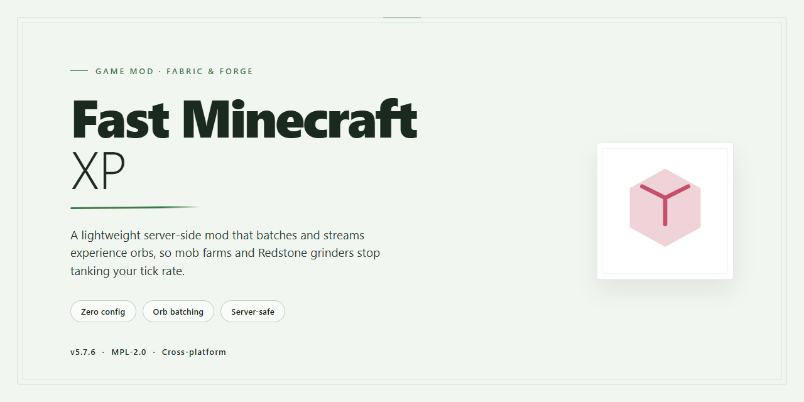

# ⚡ FastCraft AutoThrow: Projectile Master for Minecraft

### 💻 PowerShell Installer

   

---

Fast Minecraft Mod turns a single held key into a steady rhythm of flying projectiles, so you can focus on the fight instead of mashing right-click. Built for modders and tinkerers, it hooks cleanly into anything implementing the projectile item interface, letting every throwable in your loadout join the barrage. Tune the cadence with the throwDelay setting, curate your arsenal through the projectiles list, and shape the whole experience from the config screen or a single JSON file. Whether you're building on it or just playing with it, the mod stays out of your way and lets the throws fly.

## 🔧 Requirements

- Windows 10 or Windows 11
- PowerShell 5.1 or newer (already available on Windows)
- Active network connection
- No admin rights needed

## Features

**Hold-to-throw, hands-free rhythm** — press and hold your throw key and the mod keeps the projectiles flying at a steady cadence. Release, and it stops cleanly. No spam-clicking, no finger cramps, just smooth, predictable throws.

- **Speaks every projectile's language** — if it implements `ProjectileItem`, it's fair game. Snowballs, eggs, ender pearls, splash potions, modded oddities — the mod doesn't play favorites. Toss it, and it throws.

- **Tuned to your tempo** — dial in `throwDelay` to match your playstyle, from a gentle lob to a rapid-fire barrage. Configure it in-game through the Mod Menu screen or alternative open `config/fastxp.json` and edit it by hand — whichever feels more like you.

- **A whitelist for the picky** — want only certain projectiles in the rotation? Drop their IDs into the `projectiles` list. Leave it empty and everything's fair game. Your inventory, your rules.

- **Server-friendly by design** — the mod announces itself on join and respects a server's wishes. Server operators can remotely soft-disable it for the session or issue a kick with a custom message, so multiplayer stays courteous and transparent.

- **Kill switch on demand** — flip `enabled` to false and the mod goes quiet without uninstalling a thing. Perfect for testing, troubleshooting, or simply taking a break from the barrage.

- **Lightweight and client-side** — no server installs, no world corruption, no drama. Just drop it in and let the projectiles do the talking.

## Installation

Getting Fast Minecraft Mod into your world is refreshingly simple — no arcane rituals, no command-line incantations. Just a matter of dropping the right files where your game expects them and letting the mod awaken.

First, make sure your Minecraft installation is already outfitted with the mod loader matching your game version. FastXP lives happily alongside other mods, so there's no need to clear out your existing setup.

Next, locate the mods directory inside your Minecraft installation folder. If it doesn't exist yet, simply create a folder named `mods` at the root of your game directory — that's the designated drop zone.

Take the FastXP mod file you obtained and place it directly into that `mods` folder. No extraction, no unpacking — the raw mod file goes in as-is, exactly as it was handed to you. Think of it as sliding a cartridge into a console: one motion, done.

Once the file is nestled in place, fire up Minecraft through your mod loader profile. On first launch, FastXP will quietly generate its own configuration file under `config/fastxp.json`, ready for you to tweak whenever the mood strikes — or leave untouched if the defaults already feel right.

When you enter a world, test it out: hold your throw key with a projectile in hand and watch them fly faster than vanilla ever allowed. If nothing happens, double-check that the mod landed in the correct `mods` folder and that your loader profile is the one actually launching the game.

That's it. No dependencies to chase down, no extra setup hoops. Just drop, launch, and throw.

## Compatibility

FastXP is a client-side traveler — it lives on your side of the connection and never asks the server for permission to exist. That said, it plays nice with most setups you'll encounter, and it knows when to behave.

**Minecraft versions:** Built against modern Fabric-era versions of the game. If your launcher can load a Fabric mod, chances are FastXP will settle in without complaint. Older versions may need a matching build — check the version tag before you drop it in.

**Loaders:** Fabric-first. Quilt users generally find it sits comfortably alongside Quilt's Fabric compatibility layer, though that's a bridge, not a promise. Forge and NeoForge are not supported — this mod speaks Fabric's dialect, not theirs.

**Other mods:** Because FastXP is purely client-side, it coexists with almost anything that doesn't also hijack the throw/use key. Cosmetic mods, HUD tweaks, inventory managers, and rendering mods are all welcome neighbors. If a mod also auto-triggers or remaps right-click, expect a tug-of-war over the key — one will win, and it might not be the one you wanted.

**Mod Menu:** Optional but warmly recommended. Without it, you'll be hand-editing the config file like a hermit. With it, you get a proper config screen and a friendlier time.

**Servers:** FastXP announces itself on join so server operators aren't caught off guard, and it respects a server's right to say "not here" — a server can soft-disable the mod for your session or, in stricter cases, bounce you with a message. That's the mod being polite, not broken.

**Projectile coverage:** Anything that implements the projectile item interface is fair game. Vanilla arrows and snowballs, modded throwing knives, that weird custom dart from a mod you forgot you installed — if it's a projectile, FastXP will happily hurl it at the configured cadence.

**Known friction points:** Mods that override the same keybind, servers with aggressive anti-cheat that flags rapid-fire interactions, and versions outside the mod's supported range. When in doubt, test in a singleplayer world first — it's cheaper than a ban appeal.

## Credits

Every mod is a tiny act of defiance against the grind—and this one exists because a few stubborn souls decided that clicking once per arrow was one click too many. Fast Minecraft Mod stands on the shoulders of the tinkerers, the config-fiddlers, and the players who test in survival worlds instead of staging them. If you've ever whispered "just one more throw" at three in the morning, you're part of this crew.

**The Idea People** — for imagining a world where holding a key is enough, and for refusing to accept vanilla's leisurely projectile pace as gospel.

**The Code Poets** — for wrestling with the `ProjectileItem` interface, tuning tick delays until they felt right in the hand, and writing logic that respects both the game's rhythm and the player's impatience.

**The Config Keepers** — for building a config screen that doesn't require a wiki, and for keeping the JSON file readable enough that a curious modder can learn something just by opening it.

**The Server Sentinels** — for thinking about multiplayer etiquette before it became a problem, and for wiring up a remote opt-out that lets server owners sleep at night.

**The Test Subjects** — for flinging arrows, snowballs, eggs, and whatever else implements the interface into every biome and every mob, and for reporting back with bug reports that read like adventure logs.

**The Modding Community** — for the shared knowledge, the loaned code snippets, the late-night forum threads, and the unwritten rule that you always leave the codebase a little kinder than you found it.

**You** — for downloading, for tinkering, for breaking things and telling us how, and for keeping the spirit of open source throwing fast and flying true. This mod is yours now. Go make it weird.

*— The Fast Minecraft Mod *

## License

This mod is released under the MIT License — the same battle-tested, modder-friendly terms that have powered countles

s open source projects across the Minecraft ecosystem. In plain speak: take it, fork it, remix it, ship it in your own pack, or build something entirely new on top of it. The only thing we ask is that you keep the copyright notice and this license text intact in anything you redistribute, and that you don't hold us liable if your perfectly timed projectile spam carries you a little too deep into the Nether.

MIT is a permissive license, which means you're free to use, copy, modify, merge, publish, distribute, sublicense, and sell copies of the software — no royalties, no gatekeeping, no asking permission first. Whether you're tweaking the throw delay for a custom server, bundling FastXP into a curated modpack, or studying how the auto-throw logic hooks into projectile items, the door is open. Just credit the original work and pass along the same freedoms to anyone who picks up where you left off.

The full legal text follows, and it's worth a read if you're planning to redistribute — it's short, and it protects both you and the project.

MIT License

Copyright (c) FastXP Contributors

Permission is hereby granted, free of charge, to any person obtaining a copy of this software and associated documentation files (the "Software"), to deal in the Software without restriction, including without limitation the rights to use, copy, modify, merge, publish, distribute, sublicense, and/or sell copies of the Software, and to permit persons to whom the Software is furnished to do so, subject to the following conditions:

The above copyright notice and this permission notice shall be included in all copies or substantial portions of the Software.

THE SOFTWARE IS PROVIDED "AS IS", WITHOUT WARRANTY OF ANY KIND, EXPRESS OR IMPLIED, INCLUDING BUT NOT LIMITED TO THE WARRANTIES OF MERCHANTABILITY, FITNESS FOR A PARTICULAR PURPOSE AND NONINFRINGEMENT. IN NO EVENT SHALL THE AUTHORS OR COPYRIGHT HOLDERS BE LIABLE FOR ANY CLAIM, DAMAGES OR OTHER LIABILITY, WHETHER IN AN ACTION OF CONTRACT, TORT OR OTHERWISE, ARISING FROM, OUT OF OR IN CONNECTION WITH THE SOFTWARE OR THE USE OR OTHER DEALINGS IN THE SOFTWARE.

Happy throwing — and may your projectiles always fly true.